<!-- GENERATED FILE - DO NOT EDIT. Regenerate with: python rules_graph.py && python rules_map_docs.py -->

# Workflow Rules Map

> Generated by `rules_map_docs.py` from `rules/graph.json`, `docs/rules_crossref.json`, `roadmap.json` and `tasks/**/*.xml` (rules data as of 2026-10-19T14:35:40.304Z). Do not edit by hand; re-run `python rules_graph.py && python rules_map_docs.py`.

This page explains how the Encompass workflow rules connect the task templates. Part 1 is a set of pictures (one per stage, one per timer). Part 2 is a table that says, for every task, what creates it, what adds its optional subtasks, and what completes it. Anything the rules do not yet cover is shown as a dashed box or listed under *Gaps to review*, not hidden.

## How to read the pictures

- **Square box** = a task. Staff work these; a rule can create them, complete them, or react when one of their subtasks is marked Done or Issue.
- **Rounded box** = something that happens outside a task: a field changes, a file is attached, a milestone completes, or the loan is created.
- **Stadium shape with ⏱** = a timer. Timers are named only; durations are not shown.
- **Dashed box** = a task in another stage (or one with no template yet), or a gap where no known rule exists.
- **Arrow label** reads as a sentence: *"Deny: Done → creates"* means "when the Deny subtask is marked Done, Encompass creates the task the arrow points to". *"adds X"* means a rule adds the subtask X to the target task. A dotted arrow means "cancels".
- Links that stay inside one task (one subtask completing another) are left out of the stage pictures.

## Part 1: Pictures

### Stage pictures

#### Stage 1: Origination

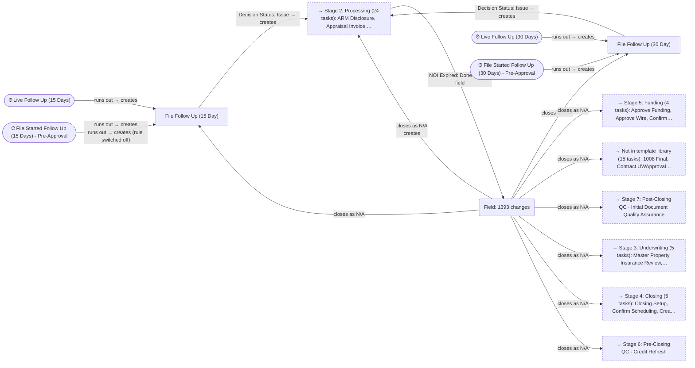

#### Stage 2: Processing — Appraisal + ARM Disclosure + AVM + Credit Review + Credit Score Disclosure + Disclosures + Flood Certificate

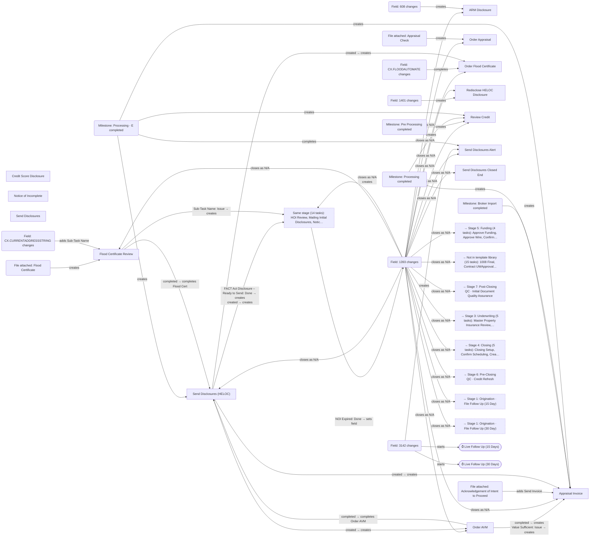

#### Stage 2: Processing — Misc

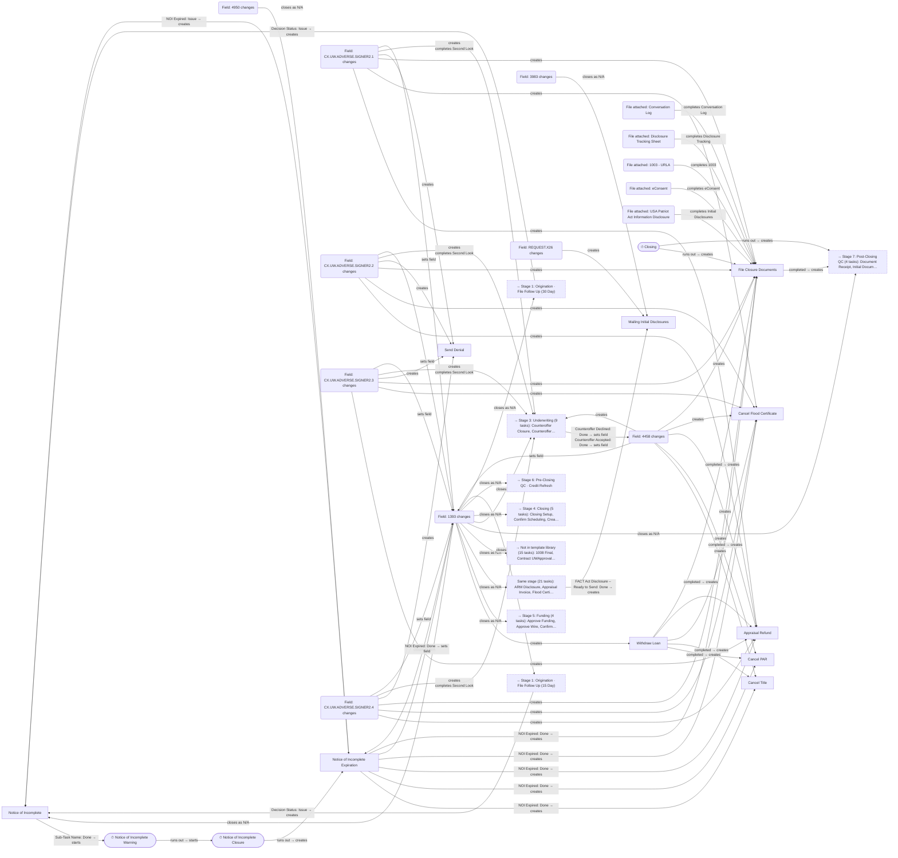

#### Stage 2: Processing — Post Underwriting + Pre Underwriting Checklist + Pull Deed + Pull Property Field Card + Service Orders + SSA-89 + Tax Transcripts + Title

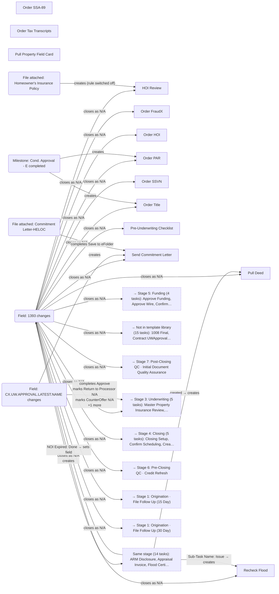

#### Stage 3: Underwriting — Post Underwriting + Resubmittal

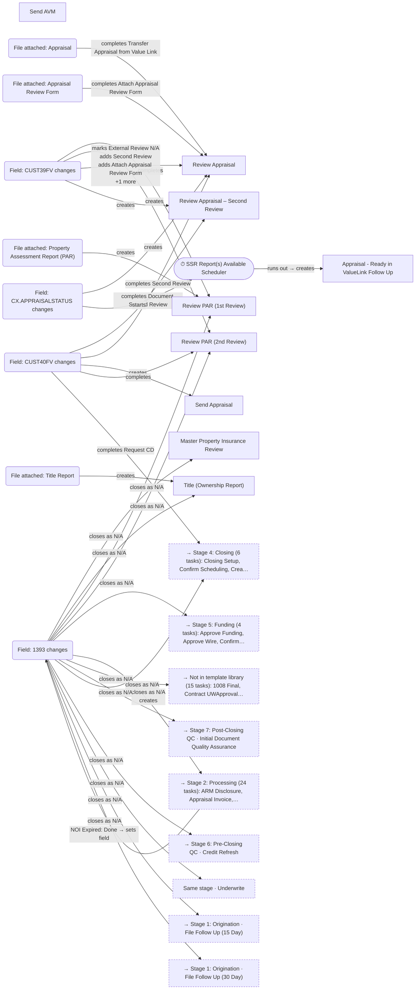

#### Stage 3: Underwriting — Submittal + UW Misc

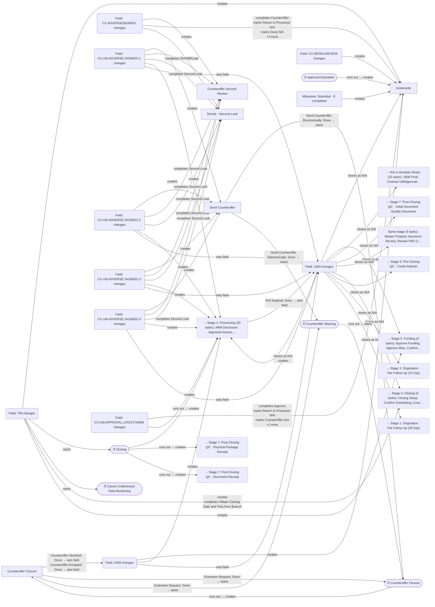

#### Stage 4: Closing

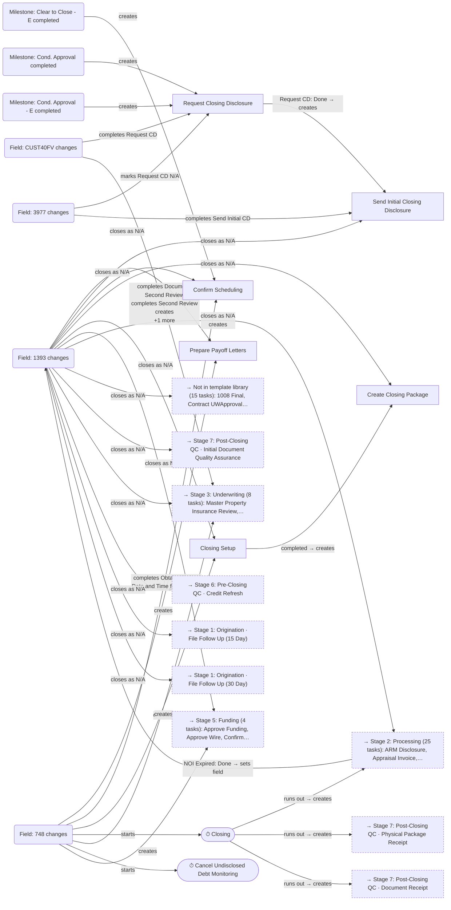

#### Stage 5: Funding

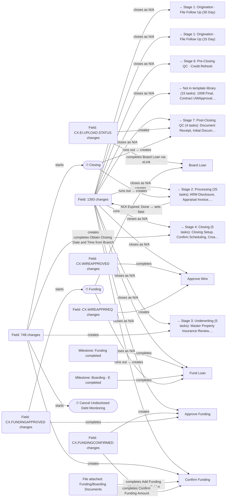

#### Stage 6: Pre-Closing QC

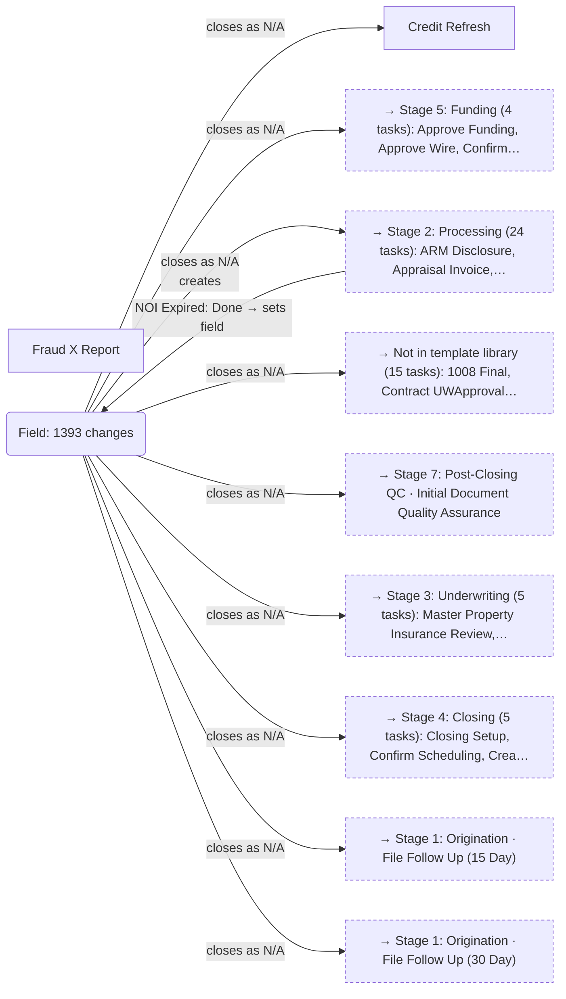

#### Stage 7: Post-Closing QC

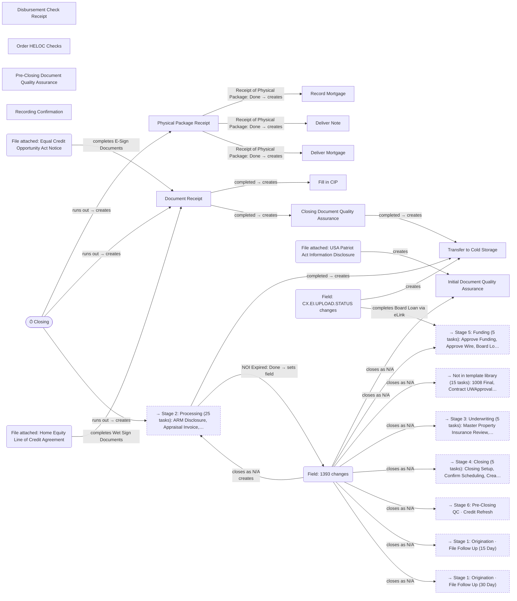

### Timer pictures

Each picture shows what starts the timer, what happens when it runs out, and (dotted) what cancels it.

#### ⏱ Approval Expiration

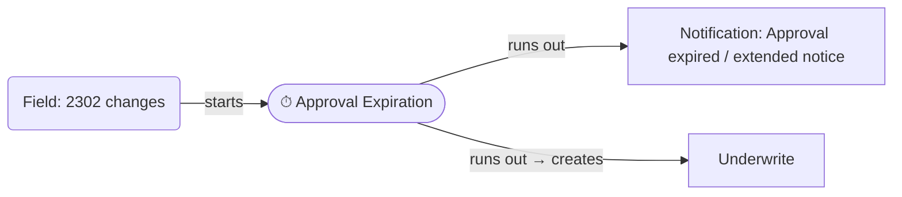

#### ⏱ Cancel Undisclosed Debt Monitoring

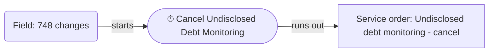

#### ⏱ Closing

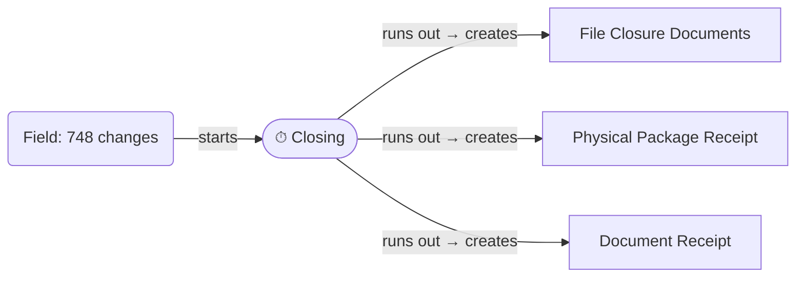

#### ⏱ Counteroffer Closure

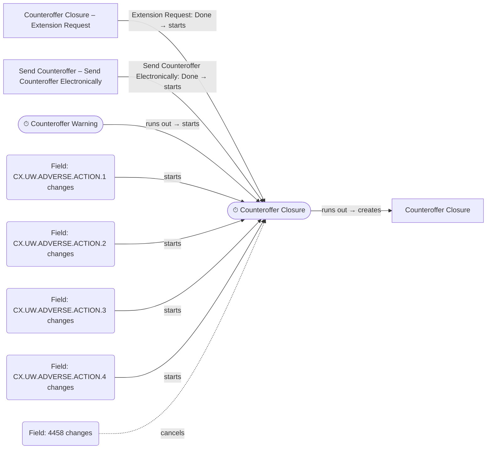

#### ⏱ Counteroffer Warning

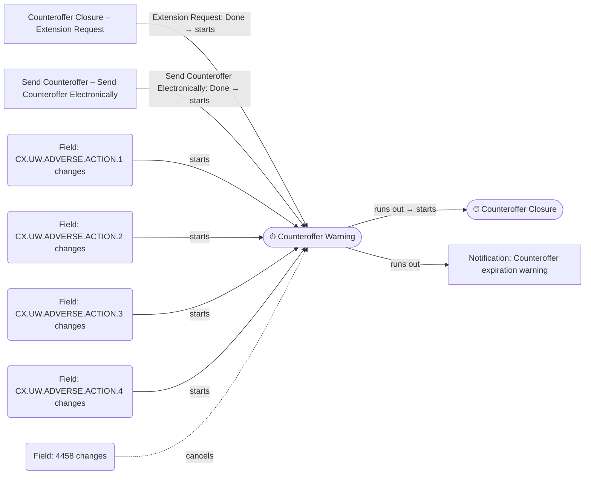

#### ⏱ Day Refresh

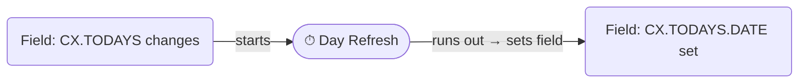

#### ⏱ File Started Follow Up (15 Days) - Pre-Approval

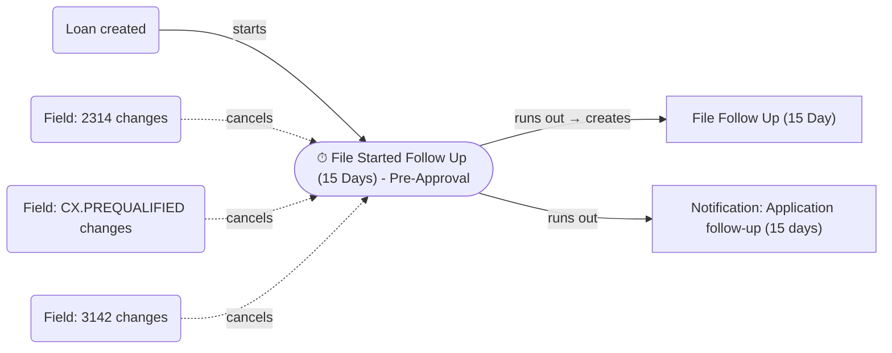

#### ⏱ File Started Follow Up (30 Days) - Pre-Approval


#### ⏱ Funding

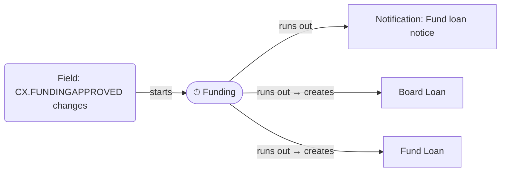

#### ⏱ Live Follow Up (15 Days)

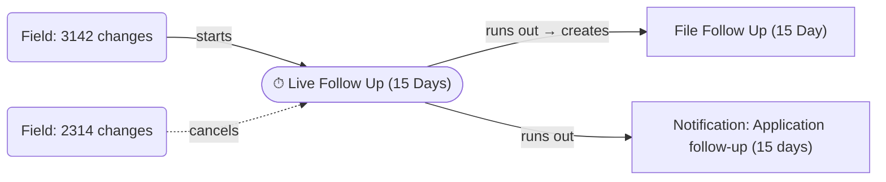

#### ⏱ Live Follow Up (30 Days)

```mermaid
flowchart LR
    n1(["⏱ Live Follow Up (30 Days)"])
    n2("Field: 3142 changes")
    n3["Notification: Application follow-up (30 days)"]
    n4["File Follow Up (30 Day)"]
    n2 -->|"starts"| n1
    n1 -->|"runs out"| n3
    n1 -->|"runs out → creates"| n4
    classDef stub stroke-dasharray: 4 3
    classDef gap stroke-dasharray: 2 4
```

#### ⏱ Notice of Incomplete Closure

```mermaid
flowchart LR
    n1(["⏱ Notice of Incomplete Closure"])
    n2(["⏱ Notice of Incomplete Warning"])
    n3("Field: 4950 changes")
    n4["Notice of Incomplete Expiration"]
    n2 -->|"runs out → starts"| n1
    n3 -.->|"cancels"| n1
    n1 -->|"runs out → creates"| n4
    classDef stub stroke-dasharray: 4 3
    classDef gap stroke-dasharray: 2 4
```

#### ⏱ Notice of Incomplete Warning

```mermaid
flowchart LR
    n1(["⏱ Notice of Incomplete Warning"])
    n2["Notice of Incomplete – Sub-Task Name"]
    n3("Field: 4950 changes")
    n4(["⏱ Notice of Incomplete Closure"])
    n5["Notification: Notice of Incomplete expiration warning"]
    n2 -->|"Sub-Task Name: Done → starts"| n1
    n3 -.->|"cancels"| n1
    n1 -->|"runs out → starts"| n4
    n1 -->|"runs out"| n5
    classDef stub stroke-dasharray: 4 3
    classDef gap stroke-dasharray: 2 4
```

#### ⏱ SSR Report(s) Available Scheduler

```mermaid
flowchart LR
    n1(["⏱ SSR Report(s) Available Scheduler"])
    n2("Field: CX.APPRAISALSTATUS changes")
    n3["Appraisal - Ready in ValueLink Follow Up"]
    n2 -->|"starts"| n1
    n2 -.->|"cancels"| n1
    n1 -->|"runs out → creates"| n3
    classDef stub stroke-dasharray: 4 3
    classDef gap stroke-dasharray: 2 4
```

## Part 2: How each task is driven

One row per task template (79 templates in `tasks/`). *Created by* lists the rules that create the task; if none is known the task is probably added by hand. *Conditional subtasks* are the ones that are not created with the task: the first column lists those a rule adds, the second those for which no rule is known yet (candidates for the rules still to come). *Done / Issue* lists subtasks whose completion triggers a rule, with the task or subtask it affects in brackets. Rule names are in code spans.

### Stage 1: Origination (2 task templates)

| Task | Created by | Conditional subtasks a rule adds | Conditional subtasks no known rule adds | Subtasks with rules on Done / on Issue | Completed by |
|---|---|---|---|---|---|
| **File Follow Up (15 Day)**<br>Pipeline Management<br>`PipelineMgt_PreApp_FollowUp15` | When the Live Follow Up (15 Days) timer runs out (only if [@2025] >= #08/19/2024# and IsEmpty([2301]) AND NOT ([1393] = "Application denied" OR [13…) `Live App Follow Up (15 Days)`<br>When the File Started Follow Up (15 Days) - Pre-Approval timer runs out (only if IsEmpty([2301]) AND NOT ([1393] = "Application denied" OR [1393] = "Application withdrawn…) `PreApp Follow Up 15`<br>When the File Started Follow Up (15 Days) - Pre-Approval timer runs out (only if [@2025] >= #08/19/2024# and IsEmpty([2301]) AND NOT ([1393] = "Application denied" OR [13…) `Pre-App Follow Up (15 Days)` | — | — | Issue: Decision Status (Task_CreateNOI_15Day) | When field 1393 changes (only if ([1393] = "Application denied" OR [1393] = "File Closed for incompleteness" OR [1393] = "…) `Task_Cancel_AllAdverse` |
| **File Follow Up (30 Day)**<br>Pipeline Management<br>`PipelineMgt_PreApp_FollowUp` | When the Live Follow Up (30 Days) timer runs out (only if [@2025] >= #08/19/2024# and IsEmpty([2301]) AND NOT ([1393] = "Application denied" OR [13…) `Live App Follow Up (30 Days)`<br>When the File Started Follow Up (30 Days) - Pre-Approval timer runs out (only if loan channel is Banked - Retail or Banked - Wholesale and [@745] >= #01/20/2026# and IsEm…) `Pre-App Follow Up (30 Days)` | — | — | Issue: Decision Status (Task_CreateNOI_30Day) | When field 1393 changes (only if ([1393] = "Application denied" OR [1393] = "File Closed for incompleteness" OR [1393] = "…) `Task_Cancel_AllAdverse` |

### Stage 2: Processing (34 task templates)

| Task | Created by | Conditional subtasks a rule adds | Conditional subtasks no known rule adds | Subtasks with rules on Done / on Issue | Completed by |
|---|---|---|---|---|---|
| **Appraisal Invoice**<br>Appraisal<br>`Processing_Appraisal_Order` | When Order AVM is completed as Issue `Task_AVMFailCompletion`<br>When Order AVM – Value Sufficient is marked Issue `Task-OrderAppraisalEquity-AVMFail`<br>When Send Disclosures (HELOC) is created (only if [#2] > 400000) `Task_HELOCIntiailDocs2`<br>+2 more | Obtain Quote (2 rules)<br>Send Invoice (3 rules) | — | Done: Obtain Quote (Subtask_QuoteComplete); Send Invoice (Appraisal Invoice Notification) | When field 1393 changes (only if ([1393] = "Application denied" OR [1393] = "File Closed for incompleteness" OR [1393] = "…) `Task_Cancel_AllAdverse` |
| **Order Appraisal**<br>Appraisal<br>`Processing_Appraisal_Ordering` | When a file is attached to the Appraisal Check document (only if [CX.TASKPILOT] = "Y") `Task_OrderAppraisal` | Automated Order (1 rule)<br>Manual Order (1 rule)<br>Quote Assignment (1 rule) | Order 1004<br>Order 1025<br>Order 1073<br>Payment Recording | Done: Automated Order (Service_AppraisalOrder) | When field 1393 changes (only if ([1393] = "Application denied" OR [1393] = "File Closed for incompleteness" OR [1393] = "…) `Task_Cancel_AllAdverse` |
| **ARM Disclosure**<br>ARM Disclosure<br>`Processing_ARM_Disclosure` | When field 608 changes to "AdjustableRate" (only if Not IsEmpty([3152]) AND [CX.LASTDISCLOSEDAMORTIZATION] <> [608]) `Amortization Type Change Notice and Task` | — | — | — | When field 1393 changes (only if ([1393] = "Application denied" OR [1393] = "File Closed for incompleteness" OR [1393] = "…) `Task_Cancel_AllAdverse` |
| **Order AVM**<br>AVM<br>`Processing_ServiceOrders_OrderAVM` | When Send Disclosures (HELOC) is created (only if [#2] <= 400000) `Task_HELOCIntiailDocs2` | — | — | Done: Ready to Send (SubTask_AVMSuccessCompletion)<br>Issue: Save AVM to eFolder (SubTask_AVMFailCompletion); Value Sufficient (Task-OrderAppraisalEquity-AVMFail) | When field 1393 changes (only if ([1393] = "Application denied" OR [1393] = "File Closed for incompleteness" OR [1393] = "…) `Task_Cancel_AllAdverse`<br>When Order AVM – Save AVM to eFolder is marked Issue `SubTask_AVMFailCompletion`<br>When Order AVM – Ready to Send is marked Done `SubTask_AVMSuccessCompletion` |
| **Review Credit**<br>Credit Review<br>`Processing_FileSetup_ReviewCredit` | When the Pre Processing milestone is completed, the Processing milestone is completed or the Processing - E milestone is completed (only if [4002] = "Firstimer" OR [CX.TASKPILOT] = "Y") `Task_CreditReview` | — | — | Done: Red Flag Form (Condition_CreditReview_RedFlagForm)<br>Issue: Address Discrepancy (Condition_CreditReview_Address); Fraud Alerts (Condition_CreditReview_Fraud); Frozen Score (Condition_CreditReview_Frozen); Name Discrepancy (Condition_CreditReview_Name); +2 more | When field 1393 changes (only if ([1393] = "Application denied" OR [1393] = "File Closed for incompleteness" OR [1393] = "…) `Task_Cancel_AllAdverse` |
| **Credit Score Disclosure**<br>Credit Score Disclosure<br>`Processing_Disclosures_CreditScoreDisclosure` | Nothing known — probably added by hand | — | — | — | Staff (no rule known) |
| **Notice of Incomplete**<br>Disclosures<br>`Processing_Disclosures_NoticeOfIncomplete` | Nothing known — probably added by hand | — | — | — | Staff (no rule known) |
| **Redisclose HELOC Disclosure**<br>Disclosures<br>`Processing_Disclosures_HELOCDisclosure` | When field 1401 changes to a value (only if [CX.DISCLOSEDPRODUCT] <> "" AND ([1172] = "HELOC") AND [CX.TASKPILOT] = "Y" AND [CX.DISCL…) `Task_HELOCImportantTermsRedisclosure` | — | — | Done: Revised Disclosure Needed (Disclosures_HELOCImportantTerms) | When field 1393 changes (only if ([1393] = "Application denied" OR [1393] = "File Closed for incompleteness" OR [1393] = "…) `Task_Cancel_AllAdverse` |
| **Send Disclosures**<br>Disclosures<br>`Processing_FileSetup_SendDisclosures` | Nothing known — probably added by hand | — | — | — | Staff (no rule known) |
| **Send Disclosures (HELOC)**<br>Disclosures<br>`Processing_FileSetup_SendDisclosuresHELOC` | When the Processing - E milestone is completed (only if ([4002] = "Firstimer" OR [CX.TASKPILOT] = "Y") AND ([1172] = "HELOC")) `Task_HELOCIntiailDocs` | Order AVM (1 rule) | — | Done: FACT Act Disclosure – Ready to Send (Disclosures_HELOCInitialDocs) | When field 1393 changes (only if ([1393] = "Application denied" OR [1393] = "File Closed for incompleteness" OR [1393] = "…) `Task_Cancel_AllAdverse` |
| **Send Disclosures Alert**<br>Disclosures<br>`Processing_FileSetup_DislosureAlert` | When field 3142 changes to a value (only if [CX.TASKPILOT] = "Y"AND ([1172] = "HELOC")) `Task_IntiailDocsAlert` | — | — | — | When field 1393 changes (only if ([1393] = "Application denied" OR [1393] = "File Closed for incompleteness" OR [1393] = "…) `Task_Cancel_AllAdverse`<br>When the Processing - E milestone is completed (only if ([4002] = "Firstimer" OR [CX.TASKPILOT] = "Y") AND ([1172] = "HELOC")) `Task_HELOCIntiailDocs` |
| **Send Disclosures Closed End**<br>Disclosures<br>`Processing_FileSetup_SendDisclosuresClosedEnd` | Nothing known — probably added by hand | — | Index | Done: FACT Act Disclosure – Ready to Send (Disclosures_ClosedEnd) | When field 1393 changes (only if ([1393] = "Application denied" OR [1393] = "File Closed for incompleteness" OR [1393] = "…) `Task_Cancel_AllAdverse` |
| **Flood Certificate Review**<br>Flood Certificate<br>`Processing_ServiceOrders_FloodCertificateReview` | When a file is attached to the Flood Certificate document (only if [4002] = "Firstimer" OR [CX.TASKPILOT] = "Y") `Task_ServiceOrders_FloodCertificateReview` | Sub-Task Name (1 rule) | — | Done: Address Matches System (FloodCertificateReview_Address)<br>Issue: Sub-Task Name (Task_FloodRecheck) | When field 1393 changes (only if ([1393] = "Application denied" OR [1393] = "File Closed for incompleteness" OR [1393] = "…) `Task_Cancel_AllAdverse` |
| **Order Flood Certificate**<br>Flood Certificate<br>`Processing_ServiceOrders_OrderFloodCertificate` | When Send Disclosures (HELOC) is created `Task_HELOCIntiailDocs2` | — | Resubmit with Supporting Documents | Done: Submit Order (Service - Flood Order Task) | When field 1393 changes (only if ([1393] = "Application denied" OR [1393] = "File Closed for incompleteness" OR [1393] = "…) `Task_Cancel_AllAdverse`<br>When Order Flood Certificate – Submit Order is marked Done (only if loan channel is Banked - Wholesale or Banked - Retail and [@3142] >= #03/01/2025#) `Service - Flood Order Task`<br>When field CX.FLOODAUTOMATE changes to "Y" (only if loan channel is Banked - Wholesale or Banked - Retail and [@3142] >= #03/01/2025#) `Service - Flood Order` |
| **Appraisal Refund**<br>Misc<br>`Processing_Misc_AppraisalRefund` | When Withdraw Loan is completed as Complete (only if Not IsEmpty([Document.DateReceived.Appraisal Check]) AND ([CX.APPRAISALSTATUS] <> "Revisi…) `Task_Post_Withdraw`<br>When Notice of Incomplete Expiration – NOI Expired is marked Done (only if Not IsEmpty([Document.DateReceived.Appraisal Check]) AND ([CX.APPRAISALSTATUS] <> "Revisi…) `TaskComplete_PostNOI`<br>When field 4458 changes (only if Not IsEmpty([Document.DateReceived.Appraisal Check]) AND ([CX.APPRAISALSTATUS] <> "Revisi…) `CounterOffer_Verdict`<br>+1 more | Cancel Appraisal (1 rule) | — | Issue: Cancel Appraisal (Task_AppraisaRefundCancel) | Staff (no rule known) |
| **Cancel Flood Certificate**<br>Misc<br>`Processing_Misc_CancelFloodCertificate` | When Withdraw Loan is completed as Complete (only if Not IsEmpty([Document.DateOrdered.Flood Certificate])) `Task_Post_Withdraw`<br>When Notice of Incomplete Expiration – NOI Expired is marked Done (only if Not IsEmpty([Document.DateReceived.Flood Certificate])) `TaskComplete_PostNOI`<br>When field 4458 changes (only if Not IsEmpty([Document.DateOrdered.Flood Certificate]) AND [4458]="Declined") `CounterOffer_Verdict`<br>+1 more | — | — | Done: Cancel Flood Certificate on Xactus Website (Subtask_CancelFlood) | Staff (no rule known) |
| **Cancel PAR**<br>Misc<br>`Processing_Misc_CancelPAR` | When Withdraw Loan is completed as Complete (only if Not IsEmpty([CX.PARORDERED]) AND IsEmpty([Document.DateReceived.Property Assessment Repor…) `Task_Post_Withdraw`<br>When Notice of Incomplete Expiration – NOI Expired is marked Done (only if Not IsEmpty([CX.PARORDERED]) AND IsEmpty([Document.DateReceived.Property Assessment Repor…) `TaskComplete_PostNOI`<br>When field 4458 changes (only if Not IsEmpty([CX.PARORDERED]) AND IsEmpty([Document.DateReceived.Property Assessment Repor…) `CounterOffer_Verdict` | — | — | — | Staff (no rule known) |
| **Cancel Title**<br>Misc<br>`Processing_Misc_CancelTitle` | When Withdraw Loan is completed as Complete (only if Not IsEmpty([CX.TITLEORDERED]) AND IsEmpty([Document.DateReceived.Title Order])) `Task_Post_Withdraw`<br>When Notice of Incomplete Expiration – NOI Expired is marked Done (only if Not IsEmpty([CX.TITLEORDERED]) AND IsEmpty([Document.DateReceived.Title Order])) `TaskComplete_PostNOI`<br>When field 4458 changes (only if Not IsEmpty([CX.TITLEORDERED]) AND IsEmpty([Document.DateReceived.Title Order])) `CounterOffer_Verdict` | — | — | — | Staff (no rule known) |
| **File Closure Documents**<br>Misc<br>`Processing_Misc_FileClosureDocuments` | When Withdraw Loan is completed as Complete `Task_Post_Withdraw`<br>When Notice of Incomplete Expiration – NOI Expired is marked Done `TaskComplete_PostNOI`<br>When field 4458 changes (only if [4458]="Declined") `CounterOffer_Verdict`<br>+2 more | 1003 (1 rule)<br>Initial Disclosures (2 rules) | — | — | Staff (no rule known) |
| **Mailing Initial Disclosures**<br>Misc<br>`Processing_Misc_MailingInitialDisclosures` | When Send Disclosures (HELOC) – FACT Act Disclosure – Ready to Send is marked Done (only if [1172]="HELOC" and IsEmpty([3983])) `Disclosures_HELOCInitialDocs`<br>When field REQUEST.X26 changes to "HELOCDOCSPLS" (only if [1172]="HELOC" and IsEmpty([3983])) `OR_Disclosures_HELOCInitialDocs` | — | — | — | When field 3983 changes to a value (only if [@3983] <= [@3143]) `Task_Cancel_Mailed Disclosures` |
| **Notice of Incomplete**<br>Misc<br>`Processing_Misc_NoticeOfIncomplete` | When File Follow Up (15 Day) – Decision Status is marked Issue `Task_CreateNOI_15Day`<br>When File Follow Up (30 Day) – Decision Status is marked Issue `Task_CreateNOI_30Day`<br>When Notice of Incomplete Expiration – NOI Expired is marked Issue `TaskComplete_NOIExtension` | — | — | Done: Sub-Task Name (Disclosures_NOI) | When field 1393 changes (only if ([1393] = "Application denied" OR [1393] = "File Closed for incompleteness" OR [1393] = "…) `Task_Cancel_AllAdverse` |
| **Notice of Incomplete Expiration**<br>Misc<br>`Processing_Misc_NOIExpiration` | When the Notice of Incomplete Closure timer runs out `NOI_Expiration_Closure` | — | — | Done: NOI Expired (TaskComplete_PostNOI)<br>Issue: NOI Expired (TaskComplete_NOIExtension) | When field 4950 changes to a value `NOI_DocsRec_Cancel`<br>When field 1393 changes (only if ([1393] = "Application denied" OR [1393] = "File Closed for incompleteness" OR [1393] = "…) `Task_Cancel_AllAdverse` |
| **Send Denial**<br>Misc<br>`Processing_Misc_SendDenial` | When any of 4 events (field CX.UW.ADVERSE.SIGNER2.1 changes, ...) occurs (only if [CX.COUNTEROFFER] <> "Y" and [CX.COUNTEROFFER] <> "Y") `Denial_SecondReview` | Credit Score Disclosure (1 rule)<br>ECOA Right to Copy of Appraisal (1 rule)<br>MA Review Board Form (1 rule)<br>Mail Counteroffer (1 rule)<br>Massachusetts MGL Disclosure (1 rule)<br>Send Counteroffer Electronically (1 rule) | — | Done: Send Counteroffer Electronically (Disclosures_Denial) | Staff (no rule known) |
| **Withdraw Loan**<br>Misc<br>`Processing_Misc_WithdrawLoan` | When field 1393 changes to "Application withdrawn" `Withdraw_TaskCreation` | — | — | Done: Send Withdrawal Notice (Disclosures_Withdrawn_Letter) | Staff (no rule known) |
| **Pre-Underwriting Checklist**<br>Pre Underwriting Checklist<br>`Processing_PreUnderwriting_PreUWChecklist` | Nothing known — probably added by hand | Non-Traditional Income (1 rule)<br>Rental Income (1 rule)<br>Run AUS (1 rule)<br>Self-Employed Income (1 rule)<br>Verify Assets (1 rule)<br>Verify Purpose (1 rule) | Verify Employment | — | When field 1393 changes (only if ([1393] = "Application denied" OR [1393] = "File Closed for incompleteness" OR [1393] = "…) `Task_Cancel_AllAdverse` |
| **Pull Deed**<br>Pull Deed<br>`Processing_FileSetup_PullDeed` | When Send Disclosures (HELOC) is created `Task_HELOCIntiailDocs2` | — | Add Non-Borrowing Owner<br>Trust | — | When field 1393 changes (only if ([1393] = "Application denied" OR [1393] = "File Closed for incompleteness" OR [1393] = "…) `Task_Cancel_AllAdverse` |
| **Pull Property Field Card**<br>Pull Property Field Card<br>`Processing_FileSetup_PullPropertyFieldCard` | Nothing known — probably added by hand | — | — | — | Staff (no rule known) |
| **Order FraudX**<br>Service Orders<br>`Processing_ServiceOrders_FraudX` | Nothing known — probably added by hand | — | Buyer Agent<br>Seller Agent<br>Sellers | Done: Order (Service_FraudX) | When field 1393 changes (only if ([1393] = "Application denied" OR [1393] = "File Closed for incompleteness" OR [1393] = "…) `Task_Cancel_AllAdverse` |
| **Order PAR**<br>Service Orders<br>`Processing_ServiceOrders_OrderPAR` | When the Cond. Approval - E milestone is completed (only if [4002] = "Firstimer" OR [CX.TASKPILOT] = "Y" and [CX.AVMACCEPTANCE] = "PASS, Sufficient") `Task_PostApprovalEquity` | — | — | Done: Place PAR Order (Subtask_PARRequest) | When field 1393 changes (only if ([1393] = "Application denied" OR [1393] = "File Closed for incompleteness" OR [1393] = "…) `Task_Cancel_AllAdverse` |
| **Order SSVN**<br>Service Orders<br>`Processing_ServiceOrders_SSVN` | Nothing known — probably added by hand | — | — | — | When field 1393 changes (only if ([1393] = "Application denied" OR [1393] = "File Closed for incompleteness" OR [1393] = "…) `Task_Cancel_AllAdverse` |
| **Recheck Flood**<br>Service Orders<br>`Processing_ServiceOrders_RecheckFloodCertificate` | When Flood Certificate Review – Sub-Task Name is marked Issue `Task_FloodRecheck` | — | — | — | When field 1393 changes (only if ([1393] = "Application denied" OR [1393] = "File Closed for incompleteness" OR [1393] = "…) `Task_Cancel_AllAdverse` |
| **Order SSA-89**<br>SSA-89<br>`Processing_ServiceOrders_OrderSSA89` | Nothing known — probably added by hand | — | — | — | Staff (no rule known) |
| **Order Tax Transcripts**<br>Tax Transcripts<br>`Processing_ServiceOrders_OrderTaxTranscripts` | Nothing known — probably added by hand | — | — | — | Staff (no rule known) |
| **Order Title**<br>Title<br>`Processing_ServiceOrders_OrderTitle` | When the Cond. Approval - E milestone is completed (only if [4002] = "Firstimer" OR [CX.TASKPILOT] = "Y") `Task_PostApprovalEquity` | Order Title Ownership Report – Equity Attorney (Trust) (1 rule)<br>Order Title Ownership Report – Old Republic (1 rule) | Obtain Quote – New Deed Prep<br>Order Title – Bank Attorney | Done: Order Title Ownership Report – Old Republic (ConditionUpdate_TitleOrderEquity) | When field 1393 changes (only if ([1393] = "Application denied" OR [1393] = "File Closed for incompleteness" OR [1393] = "…) `Task_Cancel_AllAdverse` |

### Stage 3: Underwriting (17 task templates)

| Task | Created by | Conditional subtasks a rule adds | Conditional subtasks no known rule adds | Subtasks with rules on Done / on Issue | Completed by |
|---|---|---|---|---|---|
| **HOI Review**<br>Post Underwriting<br>`Underwriting_PostUnderwriting_HOIReview` | When a file is attached to the Homeowner's Insurance Policy document (only if [CX.TASKPILOT] = "Y") `Task_HOIReview` | — | Builders Risk<br>Name of Trust | — | When field 1393 changes (only if ([1393] = "Application denied" OR [1393] = "File Closed for incompleteness" OR [1393] = "…) `Task_Cancel_AllAdverse` |
| **Master Property Insurance Review**<br>Post Underwriting<br>`Underwriting_PostUnderwriting_CondoMasterReview` | Nothing known — probably added by hand | — | Mortgagee Clause Review<br>Per-Unit Deductible Amount Review | — | When field 1393 changes (only if ([1393] = "Application denied" OR [1393] = "File Closed for incompleteness" OR [1393] = "…) `Task_Cancel_AllAdverse` |
| **Order HOI**<br>Post Underwriting<br>`Underwriting_PostUnderwriting_OrderHOI` | Nothing known — probably added by hand | — | — | — | When field 1393 changes (only if ([1393] = "Application denied" OR [1393] = "File Closed for incompleteness" OR [1393] = "…) `Task_Cancel_AllAdverse` |
| **Send Commitment Letter**<br>Post Underwriting<br>`Processing_PostUnderwriting_SendCommitmentLetter` | When field CX.UW.APPROVAL.LATEST.NAME changes to a value (only if [CX.TASKPILOT] = "Y"AND ([1172] = "HELOC")) `Task_SendApproval` | — | — | Done: Send Commitment Letter (Disclosures_Approval_CL) | When field 1393 changes (only if ([1393] = "Application denied" OR [1393] = "File Closed for incompleteness" OR [1393] = "…) `Task_Cancel_AllAdverse` |
| **Appraisal - Ready in ValueLink Follow Up**<br>Resubmittal<br>`Underwriting_Resubmittal_AppraisalReviewFollow` | When the SSR Report(s) Available Scheduler timer runs out `Task_SSRAvailableFollowUp` | — | — | — | Staff (no rule known) |
| **Review Appraisal**<br>Resubmittal<br>`Underwriting_Resubmittal_ReviewAppraisal` | When field CX.APPRAISALSTATUS changes (only if [CX.APPRAISALSTATUS] = "Report Accepted") `Task_AppraisalReview` | Attach Appraisal Review Form (1 rule)<br>Second Review (1 rule) | — | — | Staff (no rule known) |
| **Review Appraisal – Second Review**<br>Resubmittal<br>`Underwriting_Resubmittal_ReviewAppraisalSecondReview` | When field CUST39FV changes to a value (only if NOT [CUST36FV].Contains("External") AND NOT [617].Contains("PAR")) `SubTask_AppraisalExternal_Complete` | — | Attach Appraisal Review Form | — | Staff (no rule known) |
| **Review PAR (1st Review)**<br>Resubmittal<br>`Underwriting_Resubmittal_ReviewPAR` | When a file is attached to the Property Assessment Report (PAR) document (only if [4002]="Firstimer" OR [CX.TASKPILOT] = "Y") `Task_PARReview` | — | — | — | When field 1393 changes (only if ([1393] = "Application denied" OR [1393] = "File Closed for incompleteness" OR [1393] = "…) `Task_Cancel_AllAdverse`<br>When field CUST39FV changes to a value (only if documents present: Property Assessment Report (PAR) and [4002]="Firstimer" OR [CX.TASKPIL…) `Task_PARReview2` |
| **Review PAR (2nd Review)**<br>Resubmittal<br>`Underwriting_Resubmittal_ReviewPAR2` | When field CUST39FV changes to a value (only if documents present: Property Assessment Report (PAR) and [4002]="Firstimer" OR [CX.TASKPIL…) `Task_PARReview2` | — | — | — | When field 1393 changes (only if ([1393] = "Application denied" OR [1393] = "File Closed for incompleteness" OR [1393] = "…) `Task_Cancel_AllAdverse`<br>When field CUST40FV changes (only if documents present: Property Assessment Report (PAR) and [4002]="Firstimer" OR [CX.TASKPIL…) `Task_PARReview3` |
| **Send AVM**<br>Resubmittal<br>`Underwriting_Resubmittal_SendAVM` | Nothing known — probably added by hand | — | — | — | Staff (no rule known) |
| **Send Appraisal**<br>Resubmittal<br>`Underwriting_Resubmittal_SendAppraisal` | When field CUST40FV changes to a value (only if NOT [617].Contains("PAR") and NOT [617].Contains("PAR")) `Task_AppraisalReview_Complete` | — | — | Done: Send Appraisal (Disclosures_AppraisalDelivery) | Staff (no rule known) |
| **Title (Ownership Report)**<br>Resubmittal<br>`Underwriting_Resubmittal_TitleOwnershipReport` | When a file is attached to the Title Report document (only if [CX.TASKPILOT] = "Y") `Title Review` | — | — | — | When field 1393 changes (only if ([1393] = "Application denied" OR [1393] = "File Closed for incompleteness" OR [1393] = "…) `Task_Cancel_AllAdverse` |
| **Underwrite**<br>Submittal<br>`Underwriting_Submittal_Underwrite` | When field 748 changes (only if [@748] > [@2302]) `Task_ExtendApproval_ClosingDate`<br>When field 4458 changes (only if [4458]="Accepted") `CounterOffer_Verdict`<br>When field CX.DENIALREVIEW changes to a value `Processing_DenialReviewRequest`<br>+2 more | — | — | — | When field 1393 changes (only if ([1393] = "Application denied" OR [1393] = "File Closed for incompleteness" OR [1393] = "…) `Task_Cancel_AllAdverse` |
| **Counteroffer Closure**<br>UW Misc<br>`Underwriting_Misc_CounterofferClosure` | When the Counteroffer Closure timer runs out `Counteroffer_Expiration_Task` | — | — | Done: Counteroffer Accepted (CounterOffer_ClosuerTask_Accepted); Counteroffer Declined (CounterOffer_ClosuerTask_Declined); Extension Request (CounterOffer_ClosuerTask_Extend) | Staff (no rule known) |
| **Counteroffer Second Review**<br>UW Misc<br>`Underwriting_Counter_Second` | When field CX.ADVERSESIGNER1 changes to a value (only if [CX.COUNTEROFFER] = "Y" and [CX.COUNTEROFFER] = "Y") `CounterOffer_FirstReview` | — | — | — | Staff (no rule known) |
| **Denial – Second Look**<br>UW Misc<br>`Underwriting_Denial_Second` | When field CX.ADVERSESIGNER1 changes to a value (only if [CX.COUNTEROFFER] <> "Y") `Denial_FirstReview` | — | — | — | Staff (no rule known) |
| **Send Counteroffer**<br>UW Misc<br>`Underwriting_Misc_SendCounteroffer` | When any of 4 events (field CX.UW.ADVERSE.SIGNER2.1 changes, ...) occurs (only if [CX.COUNTEROFFER] = "Y") `CounterOffer_SecondReview` | MA Review Form Board Required (1 rule)<br>Mail Counteroffer (1 rule)<br>Send Counteroffer Electronically (1 rule) | — | Done: Send Counteroffer Electronically (Disclosures_Counter) | Staff (no rule known) |

### Stage 4: Closing (6 task templates)

| Task | Created by | Conditional subtasks a rule adds | Conditional subtasks no known rule adds | Subtasks with rules on Done / on Issue | Completed by |
|---|---|---|---|---|---|
| **Closing Setup**<br>Closing Setup<br>`Closing_ClosingSetup_ClosingSetup` | When field 748 changes (only if ([1172] = "HELOC")) `BranchScheduling_Complete` | — | — | — | When field 1393 changes (only if ([1393] = "Application denied" OR [1393] = "File Closed for incompleteness" OR [1393] = "…) `Task_Cancel_AllAdverse` |
| **Prepare Payoff Letters**<br>Closing Setup<br>`Closing_ClosingSetup_PreparePayoffLetters` | When field 748 changes (only if ([1172] = "HELOC") and [#URLA.X145]>0 OR [#26] > 0) `BranchScheduling_Complete` | — | — | — | When field 1393 changes (only if ([1393] = "Application denied" OR [1393] = "File Closed for incompleteness" OR [1393] = "…) `Task_Cancel_AllAdverse` |
| **Create Closing Package**<br>Doc Prep<br>`Closing_DocPrep_CreateClosingPackage` | When Closing Setup is completed as Complete `Task_ClosingPackage` | — | — | — | When field 1393 changes (only if ([1393] = "Application denied" OR [1393] = "File Closed for incompleteness" OR [1393] = "…) `Task_Cancel_AllAdverse` |
| **Confirm Scheduling**<br>Pre Closing<br>`Closing_PreClosing_Scheduling` | When the Clear to Close - E milestone is completed `BranchScheduling_CTC` | — | — | — | When field 1393 changes (only if ([1393] = "Application denied" OR [1393] = "File Closed for incompleteness" OR [1393] = "…) `Task_Cancel_AllAdverse` |
| **Request Closing Disclosure**<br>Pre Closing<br>`Closing_PreClosing_RequestClosingDisclosure` | When the Cond. Approval milestone is completed or the Cond. Approval - E milestone is completed (only if ([1172] <> "HELOC")) `Task_ICD_CreateRequest` | — | — | Done: Request CD (Task_ICD_Requested) | Staff (no rule known) |
| **Send Initial Closing Disclosure**<br>Pre Closing<br>`Closing_PreClosing_SendInitialClosingDisclosure` | When Request Closing Disclosure – Request CD is marked Done `Task_ICD_Requested` | Enter CD Issue Date (1 rule)<br>Enter Closing Date (1 rule)<br>Enter Plan Code (1 rule)<br>Reconcile Appraisal Fee (1 rule) | — | Issue: Send Initial CD (Disclosures_Early_CD) | When field 1393 changes (only if ([1393] = "Application denied" OR [1393] = "File Closed for incompleteness" OR [1393] = "…) `Task_Cancel_AllAdverse` |

### Stage 5: Funding (5 task templates)

| Task | Created by | Conditional subtasks a rule adds | Conditional subtasks no known rule adds | Subtasks with rules on Done / on Issue | Completed by |
|---|---|---|---|---|---|
| **Board Loan**<br>Boarding<br>`Funding_Boarding_BoardLoan` | When the Funding timer runs out `Task_Funding_Fund_Loan` | — | — | — | Staff (no rule known) |
| **Approve Funding**<br>Funding<br>`Funding_Funding_Approval` | When field CX.FUNDINGCONFIRMED changes to a value `Task_Funding_Funding_Request` | — | — | — | When field 1393 changes (only if ([1393] = "Application denied" OR [1393] = "File Closed for incompleteness" OR [1393] = "…) `Task_Cancel_AllAdverse`<br>When field CX.FUNDINGAPPROVED changes to a value `Task_Funding_Funding_Approval` |
| **Approve Wire**<br>Funding<br>`Funding_Wire_Approval` | When field CX.WIREAPPRREQ changes to "Y" `Task_Funding_Wire_Request` | — | — | — | When field 1393 changes (only if ([1393] = "Application denied" OR [1393] = "File Closed for incompleteness" OR [1393] = "…) `Task_Cancel_AllAdverse`<br>When field CX.WIREAPPROVED changes to a value `Task_Funding_Wire_Approval` |
| **Confirm Funding**<br>Funding<br>`Funding_Funding_ConfirmFunding` | When field 748 changes (only if ([1172] = "HELOC")) `BranchScheduling_Complete` | — | — | — | When field 1393 changes (only if ([1393] = "Application denied" OR [1393] = "File Closed for incompleteness" OR [1393] = "…) `Task_Cancel_AllAdverse` |
| **Fund Loan**<br>Funding<br>`Funding_FundLoan` | When the Funding timer runs out `Task_Funding_Fund_Loan` | — | — | — | When field 1393 changes (only if ([1393] = "Application denied" OR [1393] = "File Closed for incompleteness" OR [1393] = "…) `Task_Cancel_AllAdverse`<br>When the Funding milestone is completed or the Boarding - E milestone is completed `Task_Funding_Fund_Complete` |

### Stage 6: Pre-Closing QC (2 task templates)

| Task | Created by | Conditional subtasks a rule adds | Conditional subtasks no known rule adds | Subtasks with rules on Done / on Issue | Completed by |
|---|---|---|---|---|---|
| **Credit Refresh**<br>Funding QC<br>`FundingQC_Credit_Refresh` | Nothing known — probably added by hand | — | — | — | When field 1393 changes (only if ([1393] = "Application denied" OR [1393] = "File Closed for incompleteness" OR [1393] = "…) `Task_Cancel_AllAdverse` |
| **Fraud X Report**<br>Funding QC<br>`FundingQC_Fraud_X_Report` | Nothing known — probably added by hand | — | Appraiser License<br>Buyer Agent<br>Non-Borrowing Owners<br>Seller Agent | — | Staff (no rule known) |

### Stage 7: Post-Closing QC (13 task templates)

| Task | Created by | Conditional subtasks a rule adds | Conditional subtasks no known rule adds | Subtasks with rules on Done / on Issue | Completed by |
|---|---|---|---|---|---|
| **Deliver Mortgage**<br>Document Processing<br>`PostClosingQC_DocumentProcessing_DeliverMortgage` | When Physical Package Receipt – Receipt of Physical Package is marked Done `Task_DeliverNoteMtg` | — | Add Loan Number to First Page<br>Deliver to Secondary<br>Send to Operations<br>Upload to Identifi | — | Staff (no rule known) |
| **Deliver Note**<br>Document Processing<br>`PostClosingQC_DocumentProcessing_DeliverNote` | When Physical Package Receipt – Receipt of Physical Package is marked Done `Task_DeliverNoteMtg` | — | Add Loan Number to First Page<br>Deliver to Secondary<br>Send to Operations<br>Upload to Identifi | Done: Deliver to Secondary (Subtask_NoteDelivery_LocationSecondary); Send to Operations (Subtask_NoteDelivery_LocationOperations) | Staff (no rule known) |
| **Disbursement Check Receipt**<br>Document Processing<br>`PostClosingQC_DocumentProcessing_DisbursementCheckReceipt` | Nothing known — probably added by hand | — | — | — | Staff (no rule known) |
| **Document Receipt**<br>Document Processing<br>`PostClosingQC_DocumentProcessing_DocumentReceipt` | When the Closing timer runs out (only if ([1172] = "HELOC")) `Task_DocumentReceipt` | — | — | — | Staff (no rule known) |
| **Fill in CIP**<br>Document Processing<br>`PostClosingQC_DocumentProcessing_FillInCIP` | When Document Receipt is completed as Complete `Task_ClosingDocumentQA` | — | — | — | Staff (no rule known) |
| **Order HELOC Checks**<br>Document Processing<br>`PostClosingQC_DocumentProcessing_OrderHELOCChecks` | Nothing known — probably added by hand | — | — | — | Staff (no rule known) |
| **Physical Package Receipt**<br>Document Processing<br>`PostClosingQC_DocumentProcessing_PhysicalPackageReceipt` | When the Closing timer runs out (only if ([1172] = "HELOC")) `Task_DocumentReceipt` | — | — | Done: Receipt of Physical Package (Task_DeliverNoteMtg) | Staff (no rule known) |
| **Record Mortgage**<br>Document Processing<br>`PostClosingQC_DocumentProcessing_RecordMortgage` | When Physical Package Receipt – Receipt of Physical Package is marked Done `Task_DeliverNoteMtg` | 1-to-4 Family Rider (1 rule)<br>Condo Rider (1 rule)<br>HELOC Rider (1 rule)<br>PUD Rider (1 rule)<br>Second Home Rider (1 rule) | — | — | Staff (no rule known) |
| **Recording Confirmation**<br>Document Processing<br>`PostClosingQC_DocumentProcessing_RecordingConfirmation` | Nothing known — probably added by hand | — | — | — | Staff (no rule known) |
| **Transfer to Cold Storage**<br>Document Processing<br>`PostClosingQC_DocumentProcessing_TransferToColdStorage` | When File Closure Documents is completed as Complete (only if ([1393] = "Application denied" OR [1393] = "Application withdrawn" OR [1393] = "File Clos…) `Task_TransfertoCold_Adverse`<br>When Closing Document Quality Assurance is completed (only if [CX.EI.UPLOAD.STATUS] <> "") `Task_ColdStorage_PostBoarding`<br>When field CX.EI.UPLOAD.STATUS changes to a value (only if tasks present: PostClosingQC_QualityAssurance_ClosingDocReview) `Task_ColdStorage_Boarding` | — | — | Done: Transfer to Cold Storage (Subtask_ColdStorage) | Staff (no rule known) |
| **Initial Document Quality Assurance**<br>Initial Doc QC<br>`QualityAssurance_InitialDocReview` | When a file is attached to the USA Patriot Act Information Disclosure document (only if [4002]="Firstimer" OR [CX.TASKPILOT] = "Y" and IsEmpty([3983])) `Task_InitialDocsRec` | Sub-Task Name (1 rule)<br>1003 – Demographic Info Addendum (2 rules)<br>1003 – Demographic Info Addendum Signed (2 rules)<br>2015 Settlement Service List (2 rules)<br>Acknowledgement of Intent to Proceed (1 rule)<br>HELOC Important Terms Disclosure (1 rule)<br>+8 more | ARM Disclosure<br>CHARM Booklet<br>HELOC Booklet<br>Notice of Right to Copy of Appraisal (ECOA)<br>Privacy Policy – Opt Out Signed<br>eConsent – Docs Mailed if No eConsent | — | When field 1393 changes (only if ([1393] = "Application denied" OR [1393] = "File Closed for incompleteness" OR [1393] = "…) `Task_Cancel_AllAdverse` |
| **Closing Document Quality Assurance**<br>Quality Assurance<br>`PostClosingQC_QualityAssurance_ClosingDocReview` | When Document Receipt is completed as Complete `Task_ClosingDocumentQA` | — | — | — | Staff (no rule known) |
| **Pre-Closing Document Quality Assurance**<br>Quality Assurance<br>`PostClosingQC_QualityAssurance_PreClosingDocReview` | Nothing known — probably added by hand | — | Counteroffer<br>RI HLPA 3 Form | — | Staff (no rule known) |

## Planned roadmap tasks that rules already reference

Rules are matched to roadmap tasks by `docs/rules_crossref.json`. These roadmap tasks are marked *Planned* or *Not Started* for rules, yet at least one rule already refers to them, so the roadmap status is probably stale and the rules can be used to fill in their subtasks.

| Roadmap task | Stage | Task status | Rules status | Rules that create it | Rules that complete it | Rules that react to its subtasks |
|---|---|---|---|---|---|---|
| **File Follow Up (15 Day)** (`task_071`) | 1 Origination | completed | Planned | `Live App Follow Up (15 Days)`<br>`Pre-App Follow Up (15 Days)`<br>`PreApp Follow Up 15` | `Task_Cancel_AllAdverse` | `Task_CreateNOI_15Day` |
| **File Follow Up (30 Day)** (`task_072`) | 1 Origination | completed | Planned | `Live App Follow Up (30 Days)`<br>`Pre-App Follow Up (30 Days)` | `Task_Cancel_AllAdverse` | `Task_CreateNOI_30Day` |
| **Send Disclosures Closed End** (`task_002e`) | 2 Processing | completed | Planned | — | `Task_Cancel_AllAdverse` | `Disclosures_ClosedEnd` |
| **Appraisal Refund** (`task_054`) | 2 Processing | completed | Not Started | `CounterOffer_Verdict`<br>`Denial_SecondReview`<br>`TaskComplete_PostNOI`<br>`Task_Post_Withdraw` | — | `Task_AppraisaRefundCancel` |
| **Notice of Incomplete Expiration** (`task_060`) | 2 Processing | completed | Planned | `NOI_Expiration_Closure` | `NOI_DocsRec_Cancel`<br>`Task_Cancel_AllAdverse` | `TaskComplete_NOIExtension`<br>`TaskComplete_PostNOI` |
| **Order Appraisal** (`task_073`) | 2 Processing | completed | Planned | `Task_OrderAppraisal` | `Task_Cancel_AllAdverse` | `Service_AppraisalOrder` |
| **Order FraudX** (`task_074`) | 2 Processing | completed | Planned | — | `Task_Cancel_AllAdverse` | `Service_FraudX` |
| **Order SSVN** (`task_075`) | 2 Processing | completed | Planned | — | `Task_Cancel_AllAdverse` | — |
| **Redisclose HELOC Disclosure** (`task_076`) | 2 Processing | completed | Planned | `Task_HELOCImportantTermsRedisclosure` | `Task_Cancel_AllAdverse` | `Disclosures_HELOCImportantTerms` |
| **Send Disclosures Alert** (`task_077`) | 2 Processing | completed | Planned | `Task_IntiailDocsAlert` | `Task_Cancel_AllAdverse`<br>`Task_HELOCIntiailDocs` | — |
| **Review PAR (2nd Review)** (`task_078`) | 3 Underwriting | completed | Planned | `Task_PARReview2` | `Task_Cancel_AllAdverse`<br>`Task_PARReview3` | — |
| **Appraisal - Ready in ValueLink Follow Up** (`task_079`) | 3 Underwriting | completed | Planned | `Task_SSRAvailableFollowUp` | — | — |
| **Counteroffer Second Review** (`task_080`) | 3 Underwriting | completed | Planned | `CounterOffer_FirstReview` | — | — |
| **Denial – Second Look** (`task_081`) | 3 Underwriting | completed | Planned | `Denial_FirstReview` | — | — |
| **Counteroffer Closure** (`task_085`) | 3 Underwriting | completed | Planned | `Counteroffer_Expiration_Task` | — | `CounterOffer_ClosuerTask_Accepted`<br>`CounterOffer_ClosuerTask_Declined`<br>`CounterOffer_ClosuerTask_Extend` |
| **Closing Setup** (`task_061`) | 4 Closing | completed | Planned | `BranchScheduling_Complete` | `Task_Cancel_AllAdverse` | — |
| **Prepare Payoff Letters** (`task_062`) | 4 Closing | completed | Planned | `BranchScheduling_Complete` | `Task_Cancel_AllAdverse` | — |
| **Confirm Funding** (`task_026`) | 5 Funding | completed | Planned | `BranchScheduling_Complete` | `Task_Cancel_AllAdverse` | — |
| **Approve Funding Figures** (`task_027`) | 5 Funding | completed | Planned | `Task_Funding_Funding_Request` | `Task_Cancel_AllAdverse`<br>`Task_Funding_Funding_Approval` | — |
| **Fund Loan** (`task_028`) | 5 Funding | completed | Planned | `Task_Funding_Fund_Loan` | `Task_Cancel_AllAdverse`<br>`Task_Funding_Fund_Complete` | — |
| **Approve Wire** (`task_059`) | 5 Funding | completed | Planned | `Task_Funding_Wire_Request` | `Task_Cancel_AllAdverse`<br>`Task_Funding_Wire_Approval` | — |

Roadmap tasks with status `planned` (no template yet): **7**, of which **0** are referenced by a rule.

## Counts that reconcile with the cross-reference

| Count | This page | `docs/rules_crossref.json` | Source field |
|---|---|---|---|
| task templates (XML files) | 79 | 79 | `taskTypesInRepo` |
| templates no rule references | 12 | 12 | `orphanTaskTypes` |
| task types rules reference with no template | 17 | 17 | `brokenTaskTypes` |
| subtasks missing from templates (pairs) | 7 | 7 | `brokenSubtaskPairs` |
| roadmap tasks flagged Planned/Not Started with rules | 21 | 21 | `flaggedRulesExistButPlannedOrNotStarted` |
| rules | 192 | 192 | `rules` |
| inactive rules | 3 | 3 | `inactiveRules` |

Templates with no rule reference on this page match the cross-reference orphan list exactly: **yes**.

## Gaps to review

**Timers that are never started by a rule (0)**

- None.

**Timers with no rule that runs when they expire (0)**

- None.

**Subtasks that rules add but the template does not contain (3)**

- Complete Settlement Worksheet — in task Confirm Funding (task template exists); added by `SubTask_ConfirmFunding_Disbursement`
- 1003_QA_10 — in task Pre Approval 1003 (task has no template); added by `Task_PreApp_1003_GMI`
- 1003_QA_11 — in task Pre Approval 1003 (task has no template); added by `Task_PreApp_1003_GMI`

Other rule references to subtasks missing from the templates: **4** (completed or listened to, never added).

**Task types that rules reference but no template exists for (17)**

- 1008 Final — completes it (1 rule: `Task_Cancel_AllAdverse`)
- Contract UWApproval — completes it, creates it (2 rules: `Task_Cancel_AllAdverse`, `Task_ContractUW_Approval`)
- Flood Determination — completes it (1 rule: `Task_Cancel_AllAdverse`)
- Fraud X Report — completes it, creates it, reacts to it (3 rules: `Task_Cancel_AllAdverse`, `Task_FraudXReview`, `Task_FraudXReviewComplete`)
- HO Insurance Dates — completes it (1 rule: `Task_Cancel_AllAdverse`)
- Index Set Date — completes it (1 rule: `Task_Cancel_AllAdverse`)
- Land MLA — completes it (1 rule: `Task_Cancel_AllAdverse`)
- Loan Estimates — completes it (1 rule: `Task_Cancel_AllAdverse`)
- MI Certificate — completes it (1 rule: `Task_Cancel_AllAdverse`)
- Pre Approval 1003 — completes it, creates it, reacts to it, reacts to its subtasks, works on its subtasks (5 rules: `Disclosures_PreApp_1003`, `Fail_Disclosures_PreApp_1003`, `Task_Cancel_AllAdverse`, `Task_PreApp_1003`, …)
- Pre Approval Credit — creates it, reacts to its subtasks (2 rules: `Disclosures_PreApp_Credit`, `Task_PreApp_Credit`)
- Send AVM — creates it, reacts to its subtasks (2 rules: `Disclosures_AVM Delivery`, `Task_AVM`)
- Unknown task (Encompass ID 2d3dfd67) — completes it (1 rule: `Task_Cancel_AllAdverse`)
- Unknown task (Encompass ID 7d75e7e7) — completes it (1 rule: `Task_Cancel_AllAdverse`)
- Unknown task (Encompass ID 931feddf) — completes it (1 rule: `Task_Cancel_AllAdverse`)
- Unknown task (Encompass ID d8e42d32) — completes it (1 rule: `Task_Cancel_AllAdverse`)
- Verbal VOE — completes it (1 rule: `Task_Cancel_AllAdverse`)
